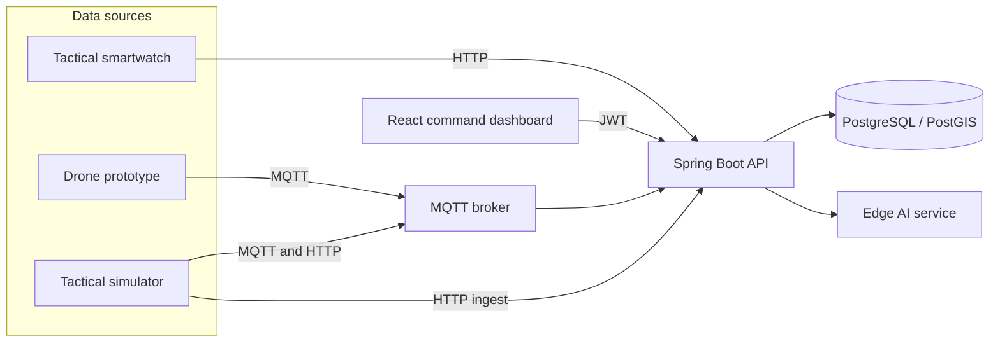

# SINAPS

**AI-Supported Lightweight C4ISR Prototype**

[](https://www.teknofest.org/)
[](LICENSE)
[](backend/pom.xml)
[](backend/pom.xml)
[](frontend/package.json)

SINAPS is an advanced, AI-driven Command, Control, Communications, Computers, Intelligence, Surveillance, and Reconnaissance (C4ISR) platform. It fuses live hardware telemetry, a built-in tactical simulator, and edge language models into one operational picture: a geospatial common operating picture, role-based command workflows, and an analyst assistant that can reason over the same event stream.

The system was selected as a **Teknofest Finalist**.

## 🎓 Academic Context & Team

SINAPS was developed by **Murat Can Barçin**, **Emirhan Güler**, and **Sarp Deniz Topaloğlu**, under the supervision of **Prof. Dr. Semih Utku**.

The SINAPS architecture, its hybrid data fusion methodology, and its threat-evaluation pipeline are currently being transformed into an academic paper and will be published in the near future.

## Overview

Operators work from a React command dashboard. Spring Boot ingests telemetry, persists it in PostgreSQL/PostGIS, and fans events out to an AI service. Gemma and Llama-class models, with an optional Groq-hosted Llama fallback, produce tactical assessments. An MQTT bus carries high-rate flight data; HTTP carries lower-rate biometric and location reports.



## Hybrid data architecture

SINAPS consumes several sources at the same time. Physical tracks and simulated tracks share one asset model. Records are marked `is_simulated`, so the simulator never overwrites a live prototype and the map can show both.

### Physical prototypes

- **Drone prototypes.** Raspberry Pi-class edge nodes publish flight telemetry on MQTT (`hardware/drone/+/telemetry`). The backend listener is the primary path. `POST /api/v1/hardware/drone/telemetry` remains as an HTTP fallback when the broker is unreachable.
- **Tactical smartwatches.** Wearable nodes post biometric and location data over HTTP to `POST /api/v1/hardware/watch/telemetry`. Heart rate and SpO2 are scored on the server. Client-supplied threat labels are discarded.

### Simulation engine

A built-in tactical simulator generates large virtual fleets for stress testing and strategic planning. `SimulationEngine` advances simulated assets on a configurable tick. Python producers (`simulation/`) can stream drone, vehicle, and soldier traffic over MQTT, and the wargame seeder can post tasks, system logs, and analysis rows. Use this path to fill a theater with hundreds of tracks without field hardware.

## Domain-agnostic flexibility

The pipeline is modular and event-driven: a source publishes a telemetry event, the backend normalizes it, PostGIS stores the geometry, and downstream services react. The same shape fits missions outside a military headquarters:

- **Disaster and emergency management (AFAD)** — damage zones, field teams, and resource convoys on one map.
- **Search and rescue** — wearable vitals, aerial search tracks, and sector assignments.
- **Global logistics and fleet tracking** — vehicles, ships, and sensors as the same asset types the dashboard already renders.

Swap the zone catalog and the asset taxonomy. The ingest, auth, and map stack stay in place.

## Tech stack

| Layer | Technologies |
| --- | --- |
| Backend | Java 17, Spring Boot 3.2, Spring Security, JWT, Spring Data JPA, Hibernate Spatial |
| Frontend | React 18, TypeScript, Vite, Tailwind CSS, Leaflet, React Router |
| Database | PostgreSQL 16, PostGIS, pgvector |
| Messaging | Eclipse Mosquitto (MQTT), HTTP ingest for wearables |
| AI | FastAPI, Gemma (edge), Llama 3.x (local fallback), optional Groq API, sentence-transformer embeddings, LoRA adapters |
| Edge middleware | Python MQTT router in front of the telemetry API |
| Simulation | Python producers plus the in-process `SimulationEngine` |
| Local ops | Docker Compose (Postgres, Mosquitto, pgAdmin, middleware) |

## Repository layout

```
backend/        Spring Boot API, MQTT listener, simulation tick, security
frontend/       Command dashboard
ai-service/     Gemma / Llama analysis and chat
simulation/     Drone, vehicle, soldier, and wargame producers
middleware/     MQTT to backend router
postgres/       PostGIS + pgvector image
mosquitto/      Broker config (anonymous listener for local development)
```

## Getting started

### Prerequisites

- Docker and Docker Compose
- JDK 17
- Node.js 18+ and npm
- Python 3.10+ (AI service and simulators)

### 1. Environment

From the repository root:

```bash
cp .env.example .env
cp .env.example ai-service/.env
cp frontend/.env.example frontend/.env
```

Edit `.env` before you boot anything:

- Set `POSTGRES_PASSWORD`, `DB_PASSWORD`, and the password inside `DATABASE_URL` to the same value.
- Set `JWT_SECRET` to a random string of at least 32 characters.
- Set `SEED_DEFAULT_PASSWORD` to the password demo accounts should receive.
- Put a Hugging Face token in `HF_TOKEN` if you load Gemma. Put a Groq key in `GROQ_API_KEY` if you want hosted Llama chat.

Load the file into your shell so Spring Boot can see it:

```bash
set -a && source .env && set +a
```

`application.properties` reads these variables. `backend/src/main/resources/application-example.properties` is a commented template only. Spring Boot does not load it.

An existing Postgres volume keeps the password it was initialized with. Compose applies `POSTGRES_PASSWORD` only on the first start of an empty data directory. Point `DB_PASSWORD` at that same value, or remove the `c4isr-postgres-data` volume for a clean database.

### 2. Database and broker

```bash
docker compose up -d postgres mosquitto
```

Postgres is published on `localhost:5433`. MQTT is on `localhost:1883`. pgAdmin, if you start it, is on `localhost:5050`.

### 3. Backend

```bash
cd backend
./mvnw spring-boot:run
```

The API listens on `http://localhost:8080`. On a fresh database the seeder creates tactical zones, assets, and these demo users (password = `SEED_DEFAULT_PASSWORD`):

| Username | Role |
| --- | --- |
| `genelkurmay_baskanligi` | `KARARGAH_ADMIN` |
| `ikinci_ordu_komutani` | `ORDU_KOMUTANI` |
| `donanma_komutani` | `ORDU_KOMUTANI` |
| `harekat_subayi_zap` | `HAREKAT_SUBAYI` |
| `harekat_subayi_idlib` | `HAREKAT_SUBAYI` |
| `harekat_subayi_akdeniz` | `HAREKAT_SUBAYI` |
| `izmir_harekat_mrkz` | `HAREKAT_SUBAYI` |

The seeder does not reset passwords when `app_users` already has rows.

### 4. AI service

```bash
cd ai-service
python -m venv .venv
source .venv/bin/activate
pip install -r requirements.txt
python -m uvicorn main:app --host 0.0.0.0 --port 8000 --reload
```

Training extras live in `requirements-train.txt`. On Windows, `ai-service/run-local.bat` is the supported launcher.

### 5. Frontend

```bash
cd frontend
npm install
npm run dev
```

Open `http://localhost:3000` and sign in. The dashboard sends `Authorization: Bearer <token>` on every API call.

### 6. Optional producers

```bash
docker compose up -d middleware
cd simulation
python drone_sim.py --host localhost --port 1883
```

The local broker accepts anonymous MQTT clients. Set `MQTT_USER` and `MQTT_PASSWORD` only if you put a broker that requires them in front of the simulators.

## Security

Authentication is stateless JWT. CSRF protection is disabled because the API does not use session cookies. CORS allows credentialed calls only from the origins in `CORS_ALLOWED_ORIGINS` (default `http://localhost:3000`).

Public routes are limited to login and to machine ingest:

- `POST /api/v1/auth/login`
- `POST /api/v1/hardware/**` (watch and drone prototypes)
- `POST /api/v1/telemetry` and `POST /api/v1/telemetry/batch`
- `POST /api/v1/tasks`, `POST /api/v1/system-logs`, `POST /api/v1/ai-analyses` (simulator seeding)

Every other route requires a valid token. `/api/v1/admin/**` additionally requires `KARARGAH_ADMIN`. Swagger UI remains open for local exploration. Bind ingest ports to a trusted network before any deployment beyond a laptop.

## License

**Non-commercial use only. Commercial use is prohibited without a written license.**

SINAPS is published under a [non-commercial dual license](LICENSE):

- **Individual developers, academic research, and non-commercial open-source contributions** may use, study, and modify this codebase under the terms in `LICENSE`.
- **Commercial use, integration into proprietary software, and monetization are strictly prohibited.** A company, product team, or any other commercial entity must obtain a separate enterprise license before using this code.

Commercial entities: contact the developers (**Murat Can Barçin**, **Emirhan Güler**, and **Sarp Deniz Topaloğlu**) and request written permission before any evaluation beyond reading the source. Using this repository in a commercial product without that license is prohibited, and the authors will take legal action.

This project is not released under the MIT License.
